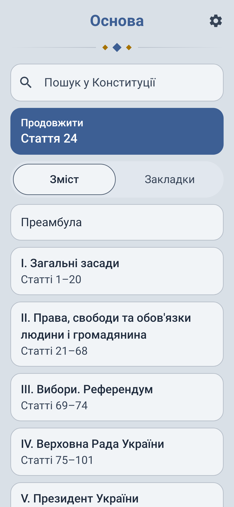
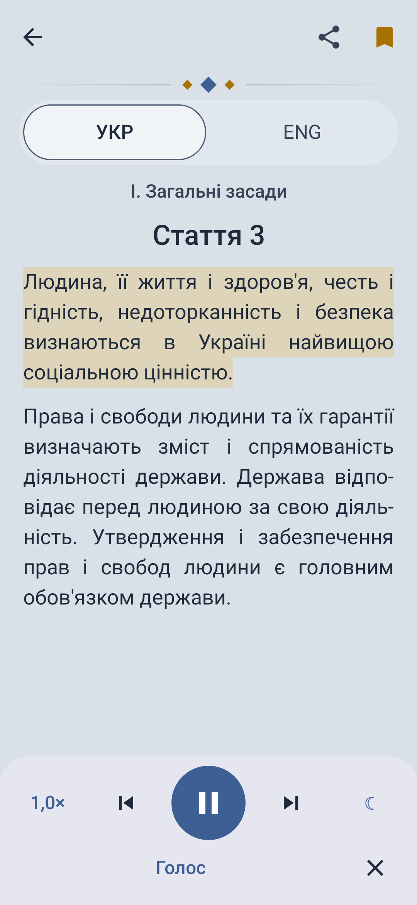
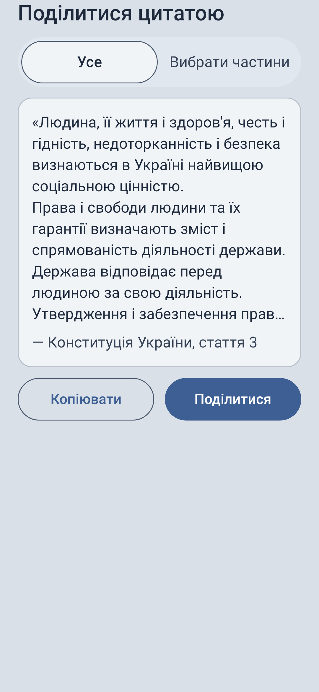
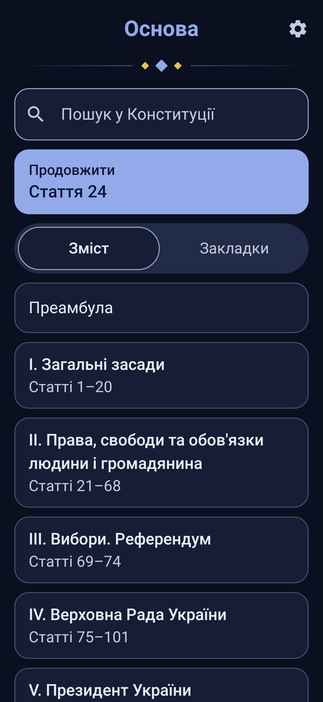

# Основа · Osnova

Конституція України в телефоні: повний текст чинної редакції українською й офіційний переклад англійською, пошук, закладки й місце, де ви зупинилися. Без інтернету, реклами, акаунтів і стеження.

<p>




</p>

- **Слово в слово** з сайту Верховної Ради: текст у застосунку щоразу збирається з закріплених джерел, і CI перевіряє, що в ньому нічого не змінено вручну ([scripts/text](scripts/text)).
- **Пошук** обома мовами, з різними формами слів; номер статті відкриває її одразу.
- **Читання вголос** без інтернету жіночими голосами Основи, тими самими, що в Грамоті (українською з правильними наголосами й англійською), або голосом телефона; читає й з вимкненим екраном. Голоси завантажуються один раз (152 і 64 МБ).
- **Поділитися цитатою:** уся стаття чи вибрані частини з посиланням, як у юристів («стаття 85, частина 2»).
- **Закладки** й «Продовжити» з того місця, де ви зупинилися.
- **Світлі й темні теми** з рідними назвами, як у Коморі, або кольори телефона.

Основа не має доступу до інтернету й нічого не збирає: [PRIVACY.md](PRIVACY.md). Голоси для читання вголос займають на телефоні 216 МБ (їх можна не завантажувати: тоді читає голос телефона).

**Встановлення:** завантажте `.apk` з [останнього випуску](../../releases/latest) на телефоні й відкрийте його. Android один раз попросить дозволити браузеру встановлювати застосунки. Потрібен Android 8 або новіший на 64-бітному процесорі ARM (arm64), як майже в усіх телефонах.

**Перевірка файлу:** відбиток ключа підпису SHA-256

```
6f495246349817b960bf8214ac4ab3831935cabe6ec381b799d760d94085224a
```

`apksigner verify --print-certs osnova-<версія>.apk`: рядок `Signer #1 certificate SHA-256 digest` має з ним збігатися.

Це не юридична консультація. Офіційний текст: [zakon.rada.gov.ua](https://zakon.rada.gov.ua/laws/show/254к/96-вр).

---

The Constitution of Ukraine on your phone: the full text of the current edition in Ukrainian and the official English translation, search, bookmarks and the place you stopped. No internet, ads, accounts or tracking.

- **Word for word** from the Verkhovna Rada's site: the text in the app is rebuilt from pinned sources each time, and CI checks nothing in it was changed by hand ([scripts/text](scripts/text)).
- **Search** in both languages, with word forms; an article number opens the article at once.
- **Reading aloud** offline in Osnova's female voices, the same as Hramota's (Ukrainian with the right stresses, and English) or the phone's voice; it reads with the screen off too. The voices are downloaded once (152 and 64 MB).
- **Share a quote:** the whole article or chosen parts, cited the way lawyers do ("Article 85, paragraph 2").
- **Bookmarks** and "Continue reading" from where you stopped.
- **Light and dark themes** with Ukrainian names, as in Komora, or the phone's colours.

Osnova has no access to the internet and collects nothing: [PRIVACY.md](PRIVACY.md). The voices for reading aloud take 216 MB on the phone (you can do without them: then the phone's own voice reads).

**Install:** download the `.apk` from the [latest release](../../releases/latest) on your phone and open it. Android asks once to let the browser install apps. Requires Android 8 or newer on a 64-bit ARM processor (arm64), as almost every phone has.

**Check the file:** `apksigner verify --print-certs osnova-<version>.apk`; the line `Signer #1 certificate SHA-256 digest` must match the fingerprint above.

This is not legal advice. The official text: [zakon.rada.gov.ua](https://zakon.rada.gov.ua/laws/show/254к/96-вр).

---

**GPL-3.0-or-later**, без жодних гарантій · without any warranty: [LICENSE](LICENSE). Бібліотеки й тексти · Libraries and texts: [NOTICE.md](NOTICE.md). Вразливості · Security: [SECURITY.md](SECURITY.md).

Код написано за допомогою ШІ (Claude, Anthropic) під керівництвом і з тестуванням авторки. · The code was written with AI (Claude, Anthropic), directed and tested by the author.
